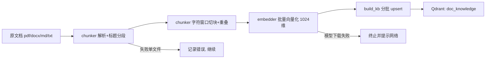

# M3 · RAG 离线建库：分块与入库设计文档

> 文档类型：LLD（详细设计）+ 数据设计
> 上游：《SmartAnalyst-完整架构设计文档》§4.4 RAG 设计、§7.2 持久化分层
> 系统阶段：Greenfield（新建模块）；受众：后端工程师
> 深度：Medium

## 1 设计概览

本设计定义 RAG **离线建库**链路：把 `doc/knowledge_base/` 下的业务口径与行业知识文档，经解析、分块、向量化后写入 Qdrant，供未来 M4 的在线混合召回使用。离线与在线严格分离——本设计只覆盖写向量库的方向，不涉及在线查询。

**范围之内**：文档解析（pdf/docx/md/txt）、分块、embedding、Qdrant collection 创建与数据灌入、建库命令入口、召回验证。
**范围之外**：在线混合召回与重排（`retriever.py`，属 M4）、增量同步策略、多租户隔离、分片。

**上游追溯**：M3 落实架构文档 §4.4 的 `chunk → embed → 写 Qdrant` 前半段，是 M4 在线检索的数据前提 `[Expert judgment]`。假定待入库文档为电商/零售经营口径与行业知识，以 md 为主 `[Hypothesis]`——这是无上游 PRD 时补齐的假设，需在建库前确认知识库真实内容格式。

**设计目标**：离线脚本可在几秒到几分钟内把一批文档完整写入向量库；重复运行不产生重复向量；任一文档解析失败不影响整批 `[Expert judgment]`。
**约束**：单机、无 GPU、模型从 HuggingFace 即时下载，因此 embedding 用 CPU 推理并容忍冷启动下载延迟 `[Expert judgment]`。

**术语**：chunk（分块后的最小文本单元）、payload（Qdrant 中每条向量携带的非向量字段）、upsert（存在则更新、不存在则插入）。

## 2 系统架构

```
┌─────────────── app/clients/ ───────────────┐
│  QdrantClientManager  (app_config.qdrant)   │
└────────────────────────────────────────────┘
             ▲ 写向量库 (upsert)
┌─────────────── app/rag/  ──────────────────┐
│                                              │
│  build_kb.py   ← 编排：扫目录→分批→写库       │
│     │            │          │                │
│     ▼            ▼          ▼                │
│  chunker.py    embedder.py                 │
│  解析+分块      向量化 (bge)                  │
└────────────────────────────────────────────┘
       ▲ 读原文            ▲ 加载模型(HuggingFace)
  doc/knowledge_base/   BAAI/bge-large-zh-v1.5
```

流程图（Mermaid）：



**技术选型理由**：

- **`pypdf` + `python-docx` + 内置文本读取**分别处理 pdf/docx/md，三者的选用依据是覆盖面与零配置，已是项目依赖，不引入新包 `[Expert judgment]`。
- **HuggingFaceEmbeddings + `BAAI/bge-large-zh-v1.5`**：架构 §4.4 指定中文场景优先 bge 系列；CPU 无显存约束下该模型在检索质量与推理成本间平衡 `[Expert judgment]`。**模型名与输出维度（1024）为其官方标注，属外部事实，如版本有更优替换须人工复核 `[To be confirmed]`**。
- **Qdrant + Cosine**：沿用 M2 已有 client；bge 归一化输出 + Cosine 是这套检索栈的常规组合 `[Expert judgment]`。

## 3 模块设计

### 3.1 `chunker`（解析 + 分块）

| 项 | 内容 |
|----|------|
| **职责** | 把单个文档文件转成带来源与序号的分块列表 |
| **输入** | 文档路径（pdf/docx/md/txt） |
| **输出** | `list[{text, source, chunk_index, title}]` |
| **依赖** | `pypdf`、`python-docx`、`jieba`（仅词数统计） |
| **边界** | 不做语义分段训练、不识别图片/表格结构，不负责向量化 |

解析按扩展名分流：pdf 用 `PdfReader` 逐页取文本并加页间换行；docx 遍历段落文本并按标题样式（Heading 1/2）记录标题；md/txt 直接按行读，把 `#`/`##` 行视为标题。分块以标题为天然边界先行切段，段内用字符窗口切块（`chunk_size=512`、`overlap=64`，初始值），窗口结尾优先落在句末标点或空行处，以降低语义割裂 `[Expert judgment]`。

### 3.2 `embedder`（向量化）

| 项 | 内容 |
|----|------|
| **职责** | 把文本块转成 1024 维归一化向量 |
| **输入** | `list[str]` 分块文本 |
| **输出** | `list[list[float]]` 向量 |
| **依赖** | `langchain_huggingface.HuggingFaceEmbeddings` |
| **边界** | 不负责建库编排，不缓存模型（由 HuggingFace 自身缓存） |

构造时指定 `model_kwargs={"device": "cpu"}` 与 `encode_kwargs={"normalize_embeddings": True}`；对外暴露 `embed_documents` 与 `embed_query` 两个方法，前者供建库批量用，后者为 M4 在线检索预留但本设计不在建库路径中调用 `[Expert judgment]`。模型首次加载会触发 HuggingFace 下载，需要网络。

### 3.3 `build_kb`（建库编排）

| 项 | 内容 |
|----|------|
| **职责** | 扫描知识库目录，编排「解析→分块→向量化→写库」并输出统计 |
| **输入** | 知识库根目录、可选 `--rebuild` 标志 |
| **输出** | Qdrant 写入点、运行统计（文件数/块数/写入点数） |
| **依赖** | `chunker`、`embedder`、`QdrantClientManager` |
| **边界** | 不解析内容、不判断语义；不负责在线查询 |

编排顺序：先保证 Qdrant 连接与目标 collection 存在（`create_collection` 幂等，`--rebuild` 时先删后建）；再逐文件 `chunk_document`，批量为文本向量化，分批 `upsert`；单文件解析或向量化异常被捕获并记数，不中断整批。写入点在集合级与文件级都用幂等键去重，保证重复运行不产生重复向量（详见第 5 节）。

## 4 数据设计

目标存储只有一个 Qdrant collection，字段定义如下：

| 字段 | 类型 | 约束 | 说明 |
|------|------|------|------|
| `id` | UUID | 稳定、由 `source+chunk_index` 派生(`uuid5`) | 重复运行 upsert 覆盖同一点，实现幂等 |
| vector | float[1024] | `Cosine` 距离 | bge-large-zh-v1.5 输出 |
| `text` | string | 必填 | 分块原文，在线侧回显与重排用 |
| `source` | string | 必填 | 文件相对知识库目录的路径，`source_ref` 溯源用 |
| `chunk_index` | int | 必填、每文件内递增 | 定位在原文档中的次序 |
| `title` | string | 可空 | 所属标题，辅助上下文 |

`payload` 的作用在两个方向：在线查询时把 `source` 作为来源引用透出到报告；调试时据此核对召回命中块落在哪个文档 `[Expert judgment]`。该模型容量按「单机、数千个块」假设设计，未引入分片与租户维度 `[Hypothesis]`。

## 5 接口设计

各模块以函数为契约（均位于 `app/rag/`）：

| 操作 | 参数 | 成功返回 | 失败行为 |
|------|------|----------|----------|
| `chunker.parse_doc(path)` | `Path` | `list[{title, text}]` 按标题分段 | 抛 `UnsupportedType`（不支持扩展名）或解析异常 |
| `chunker.chunk_document(path)` | `Path` | `list[{text, source, chunk_index, title}]` | 抛异常，由 build_kb 捕获 |
| `embedder.embed_documents(texts)` | `list[str]` | `list[list[float]]` | 抛异常（多为模型未下载/下载失败） |
| `build_kb.main()`（脚本入口） | 参数：`--knowledge-dir`、`--rebuild` | 打印统计后正常退出 | 网络/Qdrant 不可达时明确报错退出 |

脚本入口经薄封装暴露为 `scripts/build_doc_knowledge.py`，调用 `build_kb.main()`，保持单一实现 `[Expert judgment]`。collection 名统一使用常量 `doc_knowledge`，与 M4 在线侧约定一致，避免两侧手写不一致。

## 6 错误处理

| 故障 | 行为 |
|------|------|
| Qdrant 不可到达 | 启动时 `check()` 感知，明确报错并退出，不做部分写入 |
| 模型下载失败 / 网络不可用 | 首次 `embed_documents` 抛错，脚本提示检查网络后终止 |
| 单文档解析失败 | 捕获、计入失败数、继续后续文件，结束时报失败清单 |
| 单条 upsert 失败 | 依赖 Qdrant 的幂等 upsert 覆盖，重跑即可修复 |

该模块涉及外部依赖（Qdrant、HuggingFace）与网络，故内置上述重跑可修的策略；不引入重试与熔断，原因是离线脚本一次性执行、以重跑为补救手段 `[Expert judgment]`。

## 7 验证

1. 前置：Qdrant 运行中（M1），对 `QdrantClientManager` 调用 `init()`。
2. 在 `doc/knowledge_base/` 放 1–2 个 md（如「销售额口径定义.md」）。
3. 取最终脚本（薄入口）执行建库，观察日志中文件数/块数/写入点数。
4. 召回抽验：用 `embed_query("上月的销售额怎么算")` 对 `doc_knowledge` 做 top-3 查询，核验命中的 `source` 与 `text` 与语义吻合。
5. 幂等抽验：原样再运行一次，向量库点数不增长。

## 8 具体实现代码

以下五个文件与第 3–5 节设计一致，可直接落地。执行命令见第 7 节（三个参数）。注意 `app` 需为可导入包（与 `app/clients/` 一致）。

### 8.1 `app/rag/__init__.py`

```python
# RAG 离线建库模块占位，导入即空
```

### 8.2 `app/rag/chunker.py`

```python
from __future__ import annotations

from pathlib import Path
from typing import Any

import jieba

SUPPORTED = {".pdf", ".docx", ".md", ".txt"}
CHUNK_SIZE = 512
OVERLAP = 64


def _parse_pdf(path: Path) -> list[dict[str, str]]:
    from pypdf import PdfReader

    reader = PdfReader(str(path))
    segs = []
    for idx, page in enumerate(reader.pages):
        text = (page.extract_text() or "").strip()
        if text:
            segs.append({"title": f"第{idx + 1}页", "text": text})
    return segs


def _parse_docx(path: Path) -> list[dict[str, str]]:
    from docx import Document

    doc = Document(str(path))
    segs, title, buf = [], "", []
    for para in doc.paragraphs:
        text = para.text.strip()
        if not text:
            continue
        style = (para.style.name or "").lower()
        if "heading" in style or style.startswith("标题"):
            if buf:
                segs.append({"title": title, "text": "\n".join(buf)})
                buf = []
            title = text
        else:
            buf.append(text)
    if buf:
        segs.append({"title": title, "text": "\n".join(buf)})
    return segs


def _parse_text(path: Path) -> list[dict[str, str]]:
    segs, title, buf = [], "", []
    for line in path.read_text(encoding="utf-8", errors="ignore").splitlines():
        s = line.strip()
        if not s:
            continue
        if s.startswith("#"):
            if buf:
                segs.append({"title": title, "text": "\n".join(buf)})
                buf = []
            title = s.lstrip("#").strip()
        else:
            buf.append(s)
    if buf:
        segs.append({"title": title, "text": "\n".join(buf)})
    return segs


def parse_doc(path: Path) -> list[dict[str, str]]:
    ext = path.suffix.lower()
    if ext == ".pdf":
        return _parse_pdf(path)
    if ext == ".docx":
        return _parse_docx(path)
    if ext in (".md", ".txt"):
        return _parse_text(path)
    raise ValueError(f"不支持的文件类型: {ext}")


def chunk_text(text: str, chunk_size: int = CHUNK_SIZE, overlap: int = OVERLAP) -> list[str]:
    if len(text) <= chunk_size:
        return [text]
    chunks, start, n = [], 0, len(text)
    while start < n:
        end = min(start + chunk_size, n)
        window = text[start:end]
        cut = end
        for sep in ("。", "；", "\n"):
            idx = window.rfind(sep)
            if idx > chunk_size * 0.7:
                cut = start + idx + 1
                break
        chunks.append(text[start:cut])
        start = cut - overlap if cut - overlap > start else cut
    return chunks


def chunk_document(path: Path, source: str) -> list[dict[str, Any]]:
    results = []
    for seg in parse_doc(path):
        for text in chunk_text(seg["text"]):
            results.append({
                "text": text,
                "source": source,
                "chunk_index": len(results),
                "title": seg["title"],
            })
    return results


def word_count(text: str) -> int:
    return len(jieba.lcut(text))
```

### 8.3 `app/rag/embedder.py`

```python
from __future__ import annotations

from langchain_huggingface import HuggingFaceEmbeddings

EMBED_MODEL = "BAAI/bge-large-zh-v1.5"
EMBED_DEVICE = "cpu"


class Embedder:
    """bge 中文向量化封装，输出 1024 维归一化向量。"""

    def __init__(self, model: str = EMBED_MODEL, device: str = EMBED_DEVICE):
        self._embeddings = HuggingFaceEmbeddings(
            model_name=model,
            model_kwargs={"device": device},
            encode_kwargs={"normalize_embeddings": True},
        )

    def embed_documents(self, texts: list[str]) -> list[list[float]]:
        return self._embeddings.embed_documents(texts)

    def embed_query(self, query: str) -> list[float]:
        return self._embeddings.embed_query(query)


embedder = Embedder()
```

### 8.4 `app/rag/build_kb.py`

```python
from __future__ import annotations

import uuid
from pathlib import Path

from qdrant_client import models

from app.clients.qdrant_client import qdrant_client_manager
from app.rag.chunker_demo import chunk_document, word_count
from app.rag.embedder import embedder

COLLECTION = "doc_knowledge"
VECTOR_SIZE = 1024
BATCH = 100
KNOWLEDGE_DIR = Path(__file__).resolve().parents[2] / "doc" / "knowledge_base"


def _point_id(source: str, index: int) -> str:
    return str(uuid.uuid5(uuid.NAMESPACE_URL, f"{source}#{index}"))


async def _ensure_collection(client, rebuild: bool) -> None:
    if rebuild:
        try:
            await client.delete_collection(COLLECTION)
        except Exception:
            pass
    existing = {c.name for c in (await client.get_collections()).collections}
    if COLLECTION not in existing:
        await client.create_collection(
            COLLECTION,
            vectors_config=models.VectorParams(size=VECTOR_SIZE, distance=models.Distance.COSINE),
        )


async def _embed_and_upsert(client, points: list, texts: list[str]) -> None:
    vectors = embedder.embed_documents(texts)
    for point, vec in zip(points, vectors):
        point.vector = vec
    await client.upsert(COLLECTION, points=points, wait=True)


async def main(knowledge_dir: Path = KNOWLEDGE_DIR, rebuild: bool = False) -> None:
    qdrant_client_manager.init()
    client = qdrant_client_manager.client
    await _ensure_collection(client, rebuild)

    points, batch_texts = [], []
    files = failed = total_chunks = total_words = 0

    for path in sorted(knowledge_dir.rglob("*")):
        if not path.is_file() or path.suffix.lower() not in {".pdf", ".docx", ".md", ".txt"}:
            continue
        files += 1
        source = path.relative_to(knowledge_dir).as_posix()
        try:
            chunks = chunk_document(path, source)
        except Exception as exc:
            failed += 1
            print(f"[失败] {source}: {exc}")
            continue
        total_chunks += len(chunks)
        total_words += sum(word_count(c["text"]) for c in chunks)
        for c in chunks:
            batch_texts.append(c["text"])
            points.append(models.PointStruct(
                id=_point_id(c["source"], c["chunk_index"]),
                vector=None,
                payload={k: c[k] for k in ("text", "source", "chunk_index", "title")},
            ))
            if len(points) >= BATCH:
                await _embed_and_upsert(client, points, batch_texts)
                points, batch_texts = [], []

    if points:
        await _embed_and_upsert(client, points, batch_texts)

    print(f"完成：文件 {files}(失败 {failed}) / 块 {total_chunks} / 词 {total_words}")


if __name__ == "__main__":
    import asyncio

    asyncio.run(main())
```

### 8.5 `scripts/build_doc_knowledge.py`

```python
import argparse
import asyncio
from pathlib import Path

from app.rag.build_kb import KNOWLEDGE_DIR, main


def run() -> None:
    parser = argparse.ArgumentParser(description="构建文档知识库")
    parser.add_argument("--knowledge-dir", type=Path, default=KNOWLEDGE_DIR)
    parser.add_argument("--rebuild", action="store_true", help="删除并重建 collection")
    args = parser.parse_args()
    asyncio.run(main(args.knowledge_dir, args.rebuild))


if __name__ == "__main__":
    run()
```

执行（增量追加，需先在 `.env`/环境就绪且 Qdrant 运行中）：

```bash
uv run python -m scripts.build_doc_knowledge
uv run python -m scripts.build_doc_knowledge --rebuild
```

---

### 9 更新记录（chunker v2 重构）

> 本节说明分块模块的一次实质性重构。**§3.1 / §5 / §8.2 / §8.4 中的 chunker 描述均为 v1**（字符窗口 + `chunk_document` / `word_count`），请以本节 v2 为准。v2 已实际落码于 `app/rag/chunker.py`，`build_kb` 的同步属于待办（见下方"待办"）。

#### v2 相对 v1 的关键变更

1. **解析器注册表**：格式解析改为 `@_register` 注册，统一输出中间表示 `[{title, text, page}]`。新增格式只需实现一个解析函数并 `@_register`，解析层与切分层彻底解耦。
2. **切分口径升级**：由「字符窗口（`chunk_size=512` / `overlap=64`）+ rfind 句末回溯」改为 **jieba token 口径 + 句子为最小单元**。不切句、语义完整，且从结构上消除了 v1 在 `cut==n` 时重叠回退导致的**末尾重复块**问题。
3. **对外 API 变更**：删除 `chunk_document(path, source)` / `word_count()`；新增
   - `parse_doc(path)` —— 解析成块流；
   - `process_file(path, source=..., ocr_fn=...)` —— 单文件处理，异常隔离，坏文件返回空并打日志；
   - `process_batch(paths, source_fn=..., ocr_fn=...)` —— 批量生成器，单个坏文件不影响整批。
4. **幂等 id**：`chunk_id` 由 `uuid4`（随机）改为**确定性 `uuid5(source#index)`**。同源同序号的块稳定生成同一 id，重复建库 upsert 覆盖同一点，不产生重复向量（与文档第 5 节幂等约定保持一致）。
5. **输入防护**：单文件 `MAX_FILE_BYTES = 20MB`、PDF `MAX_PDF_PAGES = 200` 上限。超大文件/超长 PDF 在解析前即被拒绝，防 buffer 炸弹拖垮建库。
6. **后处理扩展**：新增 `hash` 内容去重 + `MIN_TOKENS=20` 过短碎片过滤；元数据注入字段扩展为 `chunk_id / text / title / page / source / chunk_index / tokens`。

#### 待办（破坏性影响，尚未同步 —— 属后续开发）

- `app/rag/build_kb.py` 仍执行 `from app.rag.chunker import chunk_document, word_count`，与 v2 API 冲突，导入即 `ImportError`。需改用 `process_file`，并将输出字段（v2 的 `chunk_id / page / tokens`）与 `build_kb._point_id` 的 id 生成策略统一后重写写入流程。
- 落地 `build_kb` 同步时，本章 §3.1 / §5 / §8.2 / §8.4 的描述需一并修订为 v2 口径。

召回抽验语句：

```bash
uv run python -c "import asyncio; from qdrant_client import AsyncQdrantClient; from app.rag.embedder import embedder; async def f():\n q=AsyncQdrantClient(url='http://127.0.0.1:6333')\n v=embedder.embed_query('上月的销售额怎么算')\n h=await q.query_points(collection_name='doc_knowledge', query=v, limit=3)\n [print(x.payload['source'], round(x.score,3), x.payload['text'][:60]) for x in h.points]\nasyncio.run(f())"
```